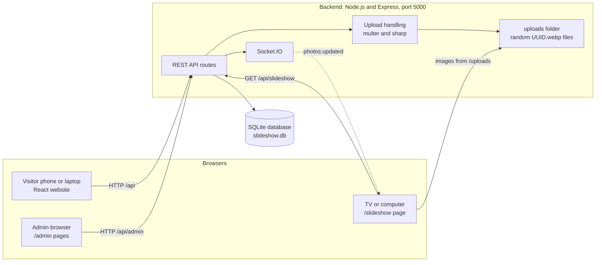
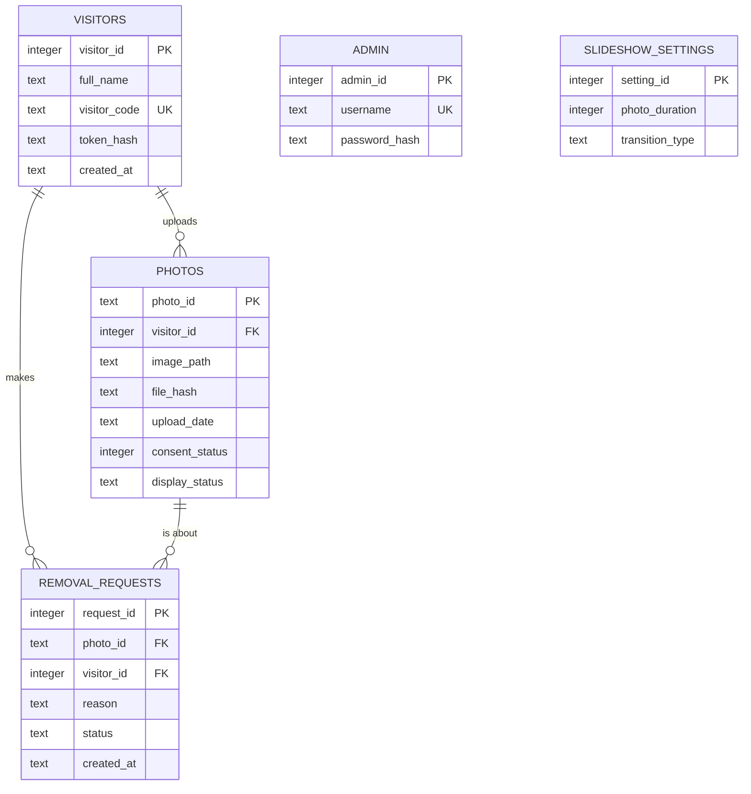
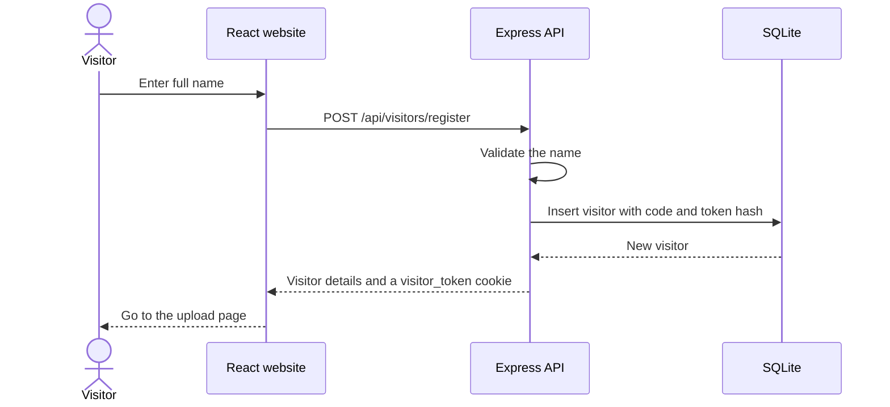
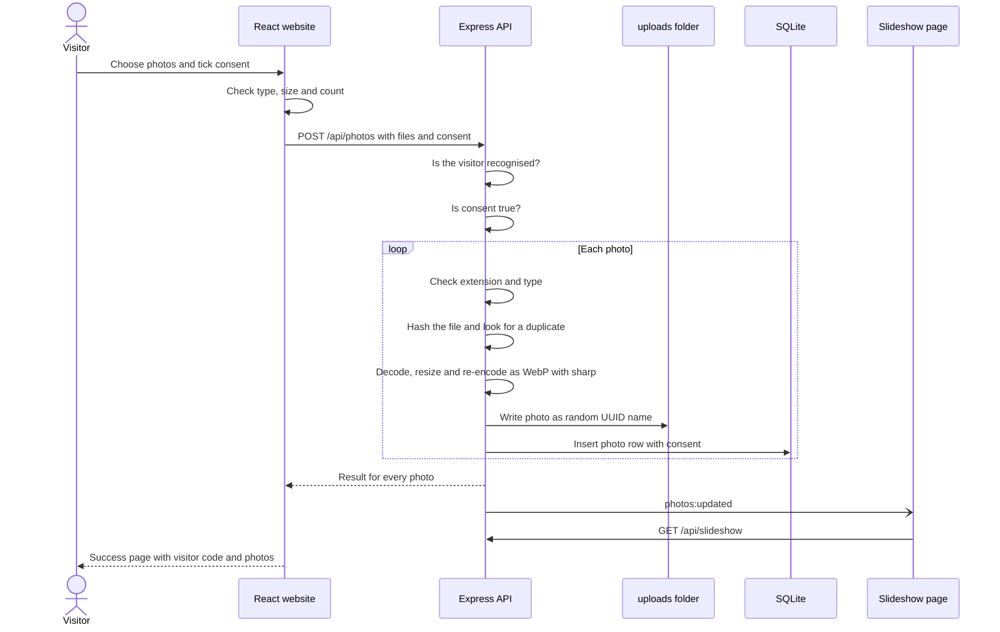
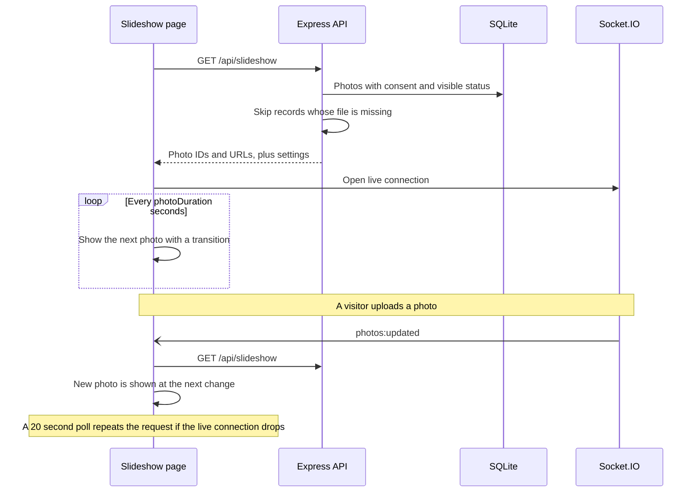
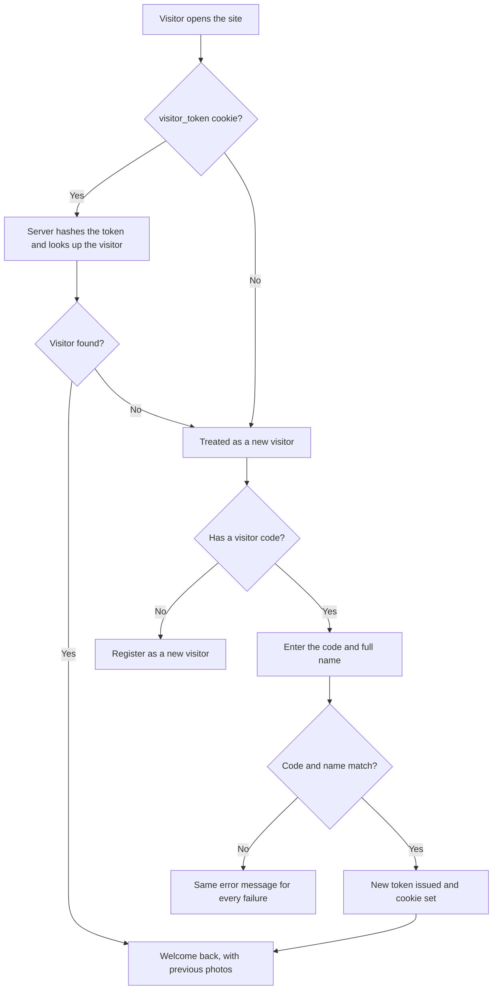

# Architecture

## 1. Overview

Visitor Photo Slideshow is a three-part system:

- **A React website** that visitors use on their phones or laptops, and that also provides the TV slideshow page and the admin area.
- **An Express API** that validates everything, stores data and files, and announces changes.
- **A SQLite database and an uploads folder** on the server's disk.

## 2. Technology stack and reasons

| Part | Choice | Why it was chosen |
|---|---|---|
| Frontend | React with Vite | Component-based, popular and fast to start. Vite is simpler than older tools. |
| Routing | React Router | Moves between pages without reloading the browser. |
| Styling | Plain CSS | Nothing extra to learn, and easy to explain. |
| Backend | Node.js with Express | JavaScript on both sides, with simple route definitions. |
| Database | SQLite (`better-sqlite3`) | A single file, free, no server to install, and writes are safe when many requests arrive together. |
| Live updates | Socket.IO | The server can push "photos changed" to every open slideshow screen. |
| Uploads | `multer` | Standard library for receiving files in Express. |
| Image safety | `sharp` | Decodes every upload (proving it is an image), resizes it and removes hidden metadata. |
| Passwords | `bcryptjs` | Deliberately slow, salted hashing. It needs no build tools on Windows, unlike `bcrypt`. |
| Tests | Vitest, Supertest, React Testing Library | Same tool for both sides, with fast tests. |
| Storage | Local `uploads` folder | Free, and allowed by the assignment for development. |

## 3. Architecture diagram



## 4. Folder structure

```
visitor-photo-slideshow/
├── package.json                  root scripts: dev (both servers) and test (all tests)
├── backend/
│   ├── .env.example              placeholder settings
│   ├── data/                     SQLite file (ignored by Git)
│   ├── uploads/                  photos (ignored by Git)
│   ├── scripts/                  simulate-uploads.js, cleanup-test-data.js
│   ├── src/
│   │   ├── app.js, server.js, db.js, config.js
│   │   ├── routes/               visitors, photos, slideshow, admin, removalRequests
│   │   ├── middleware/           identifyVisitor, adminAuth, rateLimit
│   │   └── utils/                tokens, validate, settings, seedAdmin
│   └── tests/                    health, visitors, photos, slideshow, admin
└── frontend/
    ├── vite.config.js            dev proxy to the backend, test settings
    └── src/
        ├── main.jsx, App.jsx, api.js, VisitorContext.jsx, index.css
        ├── components/           Layout, HeroStack, PhotoTile
        ├── pages/                Home, Register, Returning, Upload, Success, Slideshow, NotFound
        ├── pages/admin/          Login, Layout, Dashboard, Photos, Visitors, Settings
        └── utils/                format.js
```

## 5. Database design



### How the tables relate

- **One visitor has many photos.** `photos.visitor_id` points to `visitors.visitor_id`. Deleting a visitor deletes their photos (`ON DELETE CASCADE`).
- **A removal request belongs to one photo and one visitor.**
- **`admin` and `slideshow_settings` stand alone.** `slideshow_settings` always has exactly one row (`setting_id` is forced to 1).

### Important columns and rules

| Column or rule | Purpose |
|---|---|
| `visitors.token_hash` | Hash of the secret in the visitor's cookie. The token itself is never stored. |
| `visitors.visitor_code` | Short code for signing in on another device. It is `UNIQUE`. |
| `photos.photo_id` | A random UUID, so IDs are unique even when uploads happen together. |
| `photos.consent_status` | 1 when the visitor gave consent. Only these photos can be shown. |
| `photos.display_status` | `visible` or `hidden`. The admin can hide a photo without deleting it. |
| `UNIQUE (visitor_id, file_hash)` | Stops the same visitor saving the same photo twice. |
| `removal_requests.status` | `pending`, `approved` or `rejected`. |

A photo is shown on the slideshow only when `consent_status = 1` **and** `display_status = 'visible'`.

## 6. API overview

| Method and path | Who can use it | Purpose |
|---|---|---|
| `GET /api/health` | Anyone | Check that the server is alive |
| `POST /api/visitors/register` | Anyone | Register, or reuse the record for this browser |
| `GET /api/visitors/me` | Anyone | Who is this browser? |
| `POST /api/visitors/login` | Anyone (rate limited) | Returning visitor on a new device: code and name |
| `POST /api/visitors/logout` | Anyone | Forget this device |
| `POST /api/photos` | Registered visitor | Upload photos with consent |
| `GET /api/photos/mine` | Registered visitor | Own photos, previous and new |
| `DELETE /api/photos/:id` | Owner only | Delete own photo |
| `POST /api/removal-requests` | Owner only | Ask the admin to remove a photo |
| `GET /api/slideshow` | Anyone | Consented, visible photos and settings (no names) |
| `/api/admin/login`, `/me`, `/logout` | Anyone (login rate limited) | Admin session |
| `/api/admin/stats`, `/photos`, `/visitors`, `/settings`, `/removal-requests` | Signed-in admin only | Dashboard, moderation and settings |

## 7. Data flow

1. **Visitor to server.** The browser calls the API through `api.js`. In development, Vite forwards `/api` to the backend, so cookies work without cross-origin trouble.
2. **Server to database.** Every query uses prepared statements, which also prevents SQL injection.
3. **Server to disk.** Validated photos are written to `backend/uploads` as `<uuid>.webp`. The database keeps only the path.
4. **Server to screens.** After an upload, delete or settings change, the server emits `photos:updated`. Slideshow pages then fetch `/api/slideshow` again.

## 8. Visitor registration flow



If the browser already holds a valid cookie for the same name, the server returns the existing visitor instead of inserting a new row.

## 9. Photo upload flow



Each photo gets its own result (`saved`, `duplicate` or `rejected`), so one bad file does not hide the good ones. If the database insert fails, the file is removed again so no orphan files remain.

## 10. Slideshow flow



The page preloads the next photo, drops any image that fails to load, and shows a friendly empty screen when there are no photos.

## 11. Returning visitor flow



The server returns the same message whether the code or the name was wrong, so nobody can discover which codes exist. Previous photos come from `GET /api/photos/mine`, which returns every photo of the recognised visitor from the database, and the success page separates the new ones from the earlier ones.

## 12. Admin moderation

- **Hide** sets `display_status = 'hidden'`. The photo stays stored but the slideshow query skips it.
- **Delete** removes the database row and the image file.
- **Approving a removal request** hides the photo at once. The admin can then delete it from the photo list.
- **Deleting a visitor** removes all their photos (rows through `ON DELETE CASCADE`, files by the route).
- **Changing settings** emits `photos:updated`, so open slideshow screens pick up the new duration and transition.

## 13. Security design

| Risk | How it is handled |
|---|---|
| Showing photos without consent | The consent value is required by the server and stored per photo. The slideshow query filters on `consent_status = 1` and `display_status = 'visible'`. |
| Malicious or fake files | Extension, reported type, 5 MB limit and real decoding with `sharp`. Images are re-encoded, which removes hidden metadata. |
| Very large images | A decode limit of 50 million pixels. |
| Unsafe file names and overwriting | Random UUID names, written with an exclusive flag that refuses to overwrite. Deletes use only the file's base name. |
| Unauthorised admin access | Every admin route (except login) checks the session on the server. Passwords use bcrypt. The cookie is `HttpOnly` and `SameSite=Strict`. |
| Guessing codes or passwords | Sign-in is limited to 10 attempts per 15 minutes per IP address, and failure messages are identical. |
| Stolen database | Visitor tokens and admin passwords are stored as hashes only. |
| Exposed secrets | Settings live in `backend/.env`, which Git ignores. `.env.example` has placeholders only. |
| Private data on the public screen | The public slideshow route returns only photo IDs and URLs. Names never leave the server. |
| Touching someone else's photo | Visitors can delete or report only their own photos. Other photos get the same "not found" answer as missing ones. |
| SQL injection and script injection | Prepared statements for every query. React escapes everything it displays. |
| Other websites calling the API | CORS allows only the configured frontend address. |
| Leaking internal errors | A final error handler returns a safe message and no stack trace. |

## 14. How simultaneous uploads are handled

- Every request is independent. Each upload holds its own files in memory, with its own result list.
- Every photo gets a new UUID for its ID and its file name, and the file is written with an exclusive flag, so two uploads can never overwrite each other.
- SQLite runs in write-ahead logging mode and writes are applied one at a time, so the database stays consistent.
- `UNIQUE (visitor_id, file_hash)` protects against duplicates even if two requests race each other.
- A failed upload cleans up after itself (the file is removed if the database insert fails).
- This was checked by an automated test and by a script in which five visitors upload at the same moment.

## 15. Design limits

- Sessions and sign-in counters live in memory, so a backend restart signs the admin out.
- Local disk storage suits a single venue, not a large deployment.
- No HTTPS locally.
- One slideshow for the whole venue.